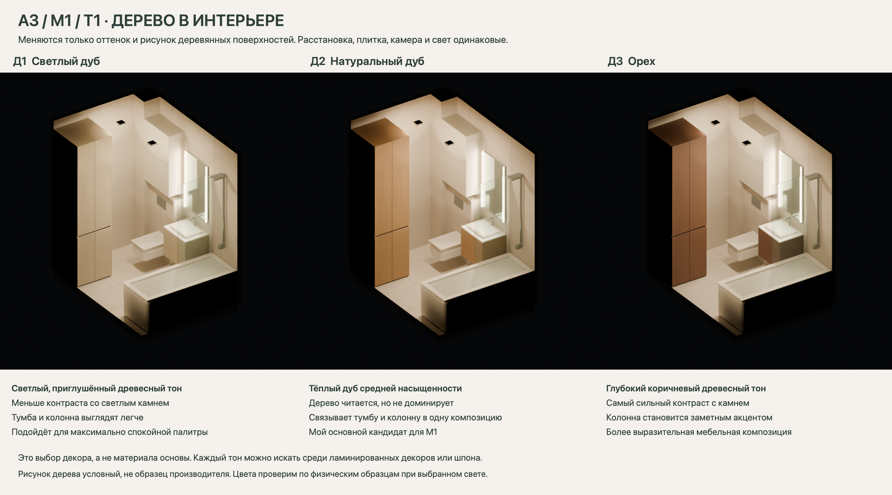
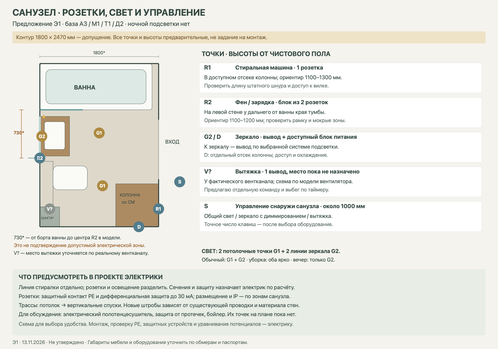

# Дизайн: схемы, сравнения и исходники

[Общая геометрия квартиры · ревизия 6](source-plan-v02/render.png). Контур по исходному плану, масштаб по окну; нужен обмер.

[Розетки, выключатели и потолки · ревизия 7](electrical-ceilings-v01/README.md).

Начните с [общего контекста](../docs/PROJECT_CONTEXT.md) и [реестра решений](../docs/bathroom-spec.json).

## Текущее направление

Выбрано A / A3 / M1 / T1 / У1 / Д2. Электрический полотенцесушитель нужен, но на схеме Э1 его ещё нет. Все линейные размеры условные.





## Каталог

| Этап | Изображение | Источник | Статус |
|---|---|---|---|
| Исходные схемы | [План](bathroom-v01/01-layout.png), [развёртки](bathroom-v01/02-elevations.png), [инженерия](bathroom-v01/03-services.png) | `parameters.json`, `build.py` | Ранняя концепция |
| Расстановка | [A / B / C](bathroom-v01/bathroom-layout-options.png) | `bathroom-layout-options.json` | Выбран A |
| Объёмы | [3D](bathroom-v01/bathroom-volumes-comparison.png) | `layout-studies.glb` | История сравнения |
| Мебельная композиция | [A1 / A2 / A3](bathroom-v01/bathroom-a-compositions.png) | `bathroom-a-compositions.json` | Выбран A3 |
| Материалы | [M1 / M2 / M3](bathroom-v01/bathroom-a3-materials.png) | `bathroom-a3-materials.json` | Выбран M1 |
| Свет | [Схема](bathroom-v01/a3-lighting-plan.png) | `bathroom-a3-lighting.json` | G1/G2 — предложение |
| Плитка | [T1 / T2 / T3](bathroom-v01/bathroom-a3-tiles.png), [развёртки](bathroom-v01/a3-tile-elevations.png) | `bathroom-a3-tiles.json` | Выбран T1 |
| Углы | [У1 / У2](bathroom-v01/bathroom-corner-choices.png) | `corner_choices.py` | Выбран У1 |
| Дерево | [Д1 / Д2 / Д3](bathroom-v01/bathroom-a3-wood.png) | `bathroom-a3-wood.json` | Выбран Д2 |
| Основа фасадов | [Ф1 / Ф2 / Ф3](bathroom-v01/bathroom-facade-materials.png) | `bathroom-facade-proposal.json` | Открыто |
| Электрика | [Э1](bathroom-v01/bathroom-electrical-e1.png) | `electrical_plan.py` | Открыто, дополнить полотенцесушителем |

Ранние варианты и `a3-light-night.png` сохранены как история, не как текущая спецификация. Ночная подсветка исключена. ZIP-дубликаты и журналы выполнения в репозиторий не включены; сами исходники, GLB, метаданные, результаты проверок, SVG и PNG сохранены.

## Воспроизведение

Из корня репозитория, после `npm ci`:

```sh
node scripts/export-layout-studies.mjs bathroom-a3-wood.json a3-wood
# Замените исполняемый файл на путь своей установки Blender:
blender --background --python scripts/blender/render_wood_study.py
```

На macOS:

```sh
/Applications/Blender.app/Contents/MacOS/Blender --background --threads 6 --python scripts/blender/render_wood_study.py
swift -module-cache-path /tmp/home-design-swift-cache design/bathroom-v01/compose_wood.swift design/bathroom-v01
python3 design/bathroom-v01/electrical_plan.py
swift -module-cache-path /tmp/home-design-swift-cache design/bathroom-v01/render.swift design/bathroom-v01/bathroom-electrical-e1.svg design/bathroom-v01/bathroom-electrical-e1.png 1400
```

Скрипты исследований используют GLB и метаданные внутри `design/bathroom-v01`; для каждого исследования есть соответствующий `render_*study.py`. Это отдельный путь от CLI `npm run render:quality`, который берёт модель приложения. Не путать результаты этих сцен.

GLB содержит геометрию и базовые материалы. Blender добавляет процедурные фактуры и свет, сверяя состав и габариты деталей по metadata. `*-validation.json` и `*-render-report.json` — результаты конкретных прогонов; после изменения геометрии их надо пересоздать. Радиометрические render watts не являются электрической мощностью приобретаемых светильников.
